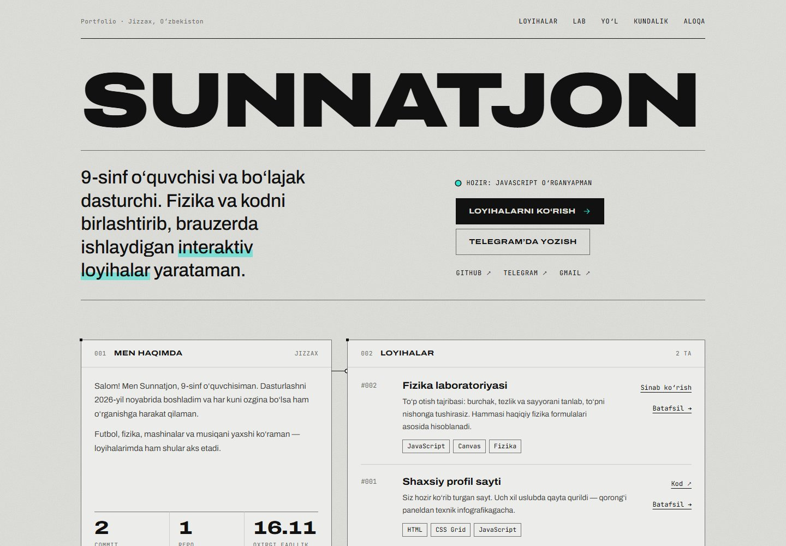

# Sunnatjon Gulboyev — shaxsiy profil sayti

9-sinf o‘quvchisi va bo‘lajak dasturchining portfoliosi: texnik “infografika” uslubidagi shaxsiy sayt.

## Saytda nimalar bor

- **Bosh qism** — kimligim bir jumlada, loyihalarga va Telegram’ga tugmalar, GitHub havolasi
- **Men haqimda** — qisqa tanishuv va GitHub’dan **avtomatik** olinadigan haqiqiy raqamlar (commitlar, repolar, oxirgi faollik)
- **Loyihalar** — har biri uchun alohida sahifa: maqsad, qanday ishlaydi, qiyinchiliklar, nimani o‘rgandim
- **Fizika laboratoriyasi** — to‘p otish tajribasi: burchak, tezlik va sayyorani (Yer, Mars, Oy) tanlab, to‘pni nishonga tushirish
- **Dasturchi yo‘li** va **Ko‘nikmalar** — foizsiz, halol darajalar: tanishman / o‘rganyapman / rejada
- **O‘rganish kundaligi** — nimani qachon o‘rganganim
- **Interaktiv terminal** — `yordam`, `loyihalar`, `kundalik`, `hazil` kabi buyruqlar
- **Aloqa** — Telegram, Gmail, GitHub va xabar yozish shakli
- Telefon, planshet va kompyuterga moslashgan; klaviatura bilan boshqariladi; animatsiyalarni o‘chirgan foydalanuvchilar uchun harakatsiz rejim

## Fayllar

| Fayl | Vazifasi |
|---|---|
| `index.html` | Bosh sahifa |
| `loyihalar/*.html` | Loyihalar haqida batafsil sahifalar |
| `style.css` | Dizayn, ranglar, animatsiyalar |
| `script.js` | Interaktivlik: GitHub ma’lumotlari, laboratoriya, kundalik, terminal |

## Mualliflik

Sayt **Claude** (sun’iy intellekt) yordamida qurilgan. G‘oyalar, mazmun va dizayn tanlovlari — meniki; kodni o‘qib, o‘rganib boryapman.

Shriftlar: [Archivo](https://fonts.google.com/specimen/Archivo) (keng sarlavhalar) va [JetBrains Mono](https://fonts.google.com/specimen/JetBrains+Mono).
Hech qanday framework yoki o‘rnatish talab qilinmaydi — oddiy HTML, CSS va JavaScript.

## Kompyuterda ochish

`index.html` faylini brauzerda oching.

## Aloqa

- Gmail: gulbayevsunnatjon@gmail.com
- Telegram: [@sunnatjon_dev](https://t.me/sunnatjon_dev)
